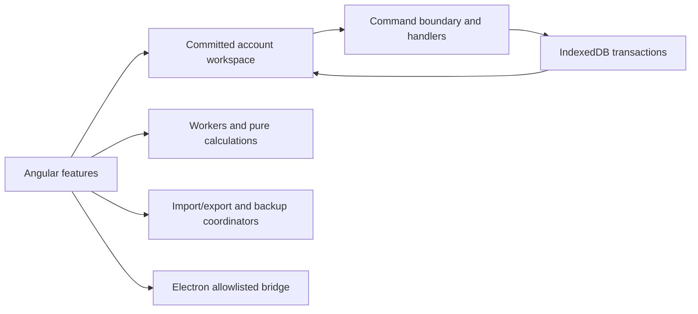

# VERIFI architecture

This is the system boundary map. Source and executable configuration define current implementation details. Use the [task router](docs/agents/context-index.md) to load only the reference needed for a change.

## System context

VERIFI is one Angular renderer delivered for browsers and Electron. IndexedDB stores user records locally; remote boundaries supply weather and reference data; Web Workers run expensive deterministic calculations. UI presentation is versioned, while data, calculation, backup, and runtime contracts are shared.

`src/app/v0/` owns the legacy experience. `src/app/v1/` owns the production unified workspace. Neutral contracts live under `data/`, `domain/`, `platform/`, and `shared/`; production v1 and neutral code never import `@v0/*`. NgModules remain the application pattern. Folder boundaries do not redefine saved record identities or public file formats.

## Startup and application shell

[`src/main.ts`](src/main.ts) bootstraps [`AppModule`](src/app/app.module.ts). [`ApplicationLifecycleService`](src/app/application-lifecycle/application-lifecycle.service.ts) owns idempotent initialization: persistence, ordered migrations, metadata/reference data, account catalog, initial workspace, optional Electron metadata, then automatic-backup observation. Concurrent initialization shares one operation and failures support retry. [`AppComponent`](src/app/app.component.ts) renders initializing/error/switching states without querying repositories.

Creation/import activates persisted accounts through the lifecycle service so catalog, workspace, and empty/ready state change coherently. The complete catalog includes deletion-marked accounts; ordinary navigation uses usable accounts. Readiness guards wait for the required persistence/account/facility state before activating routes. Account/facility resolution uses GUIDs and request identity so obsolete asynchronous switches cannot publish.

[`AppRoutingModule`](src/app/routing/app-routing.module.ts) sends root navigation to `/v1`, lazy-loads v1, and retains legacy public URLs through the v0 shell. Unknown legacy URLs use its page-not-found component; unknown v1 section routes follow workspace recovery. The root owns application-wide runtime hosts; versioned shells own their navigation, route outlets, and presentation overlays. [Workspace architecture](docs/v1-workspace-architecture.md) owns scope, guarded navigation, inventories, support presentation, and single-facility behavior.

A failed record migration exposes recovery before any workspace publishes. Recovery reads metadata and the full migration dataset in one readonly transaction and exports a support snapshot through the browser/Electron file gateway. Only after successful export may a confirmed database reset proceed. Support snapshots are not ordinary restorable backups.

## Domain and persistence

[`_dbConfig.ts`](src/app/data/indexedDB/_dbConfig.ts) and [`IndexedDBModule`](src/app/data/indexedDB/indexed-db.module.ts) configure persistence. Repository services own store queries/writes, not active collections, navigation, selection hints, or notifications. Numeric IndexedDB `id` values are local keys; `guid` values define account, facility, and cross-record relationships.

[`AccountWorkspaceStore`](src/app/data/account-workspace/account-workspace.store.ts) publishes one atomic readonly account snapshot, derived facility collections, validated selections, and a committed revision. Feature editors clone records rather than mutating published values. [`AccountWorkspaceService`](src/app/data/account-workspace/account-workspace.service.ts) owns account loading, GUID selections, hints, and coherent refreshes; stale switches cannot publish.

Ordinary user writes flow through [`WorkspaceCommandBoundary`](src/app/data/account-workspace/workspace-command-boundary.service.ts) and focused domain handlers. It coordinates pending state, validation, persistence, one committed publication, and one change event per logical operation. Committed reload is the default; patch publication is opt-in and must cover every affected record. Components and feature services do not write repositories directly. [Data workflow](docs/data-access-and-workspace.md) owns practical API selection, read/edit/queue examples, and publication recovery.

Compound invariants use one native [`IndexedDbTransactionService`](src/app/data/indexedDB/indexed-db-transaction.service.ts) transaction. Validate complete account/facility/resource ownership and reviewed snapshots, recheck durable state where required, and perform all participating writes through its transaction-bound context. Calling an ordinary repository inside it opens an unrelated transaction. A request failure aborts all writes; publish only after commit. Distinguish rejected persistence from committed-but-unpublished results: recover the latter by read/publication without replaying mutation. Infrastructure cascades keep every participating store/reference update in their declared transaction before refreshing catalog/workspace.

Schema and record migrations are independent. Store/index changes intentionally increment the database version and test an old schema. Record migrations use the ordered pure registry and data version; each migration and application metadata commit atomically before startup publishes. Current-version records are not rewritten. Local upgrades and backup preparation share migration semantics; test empty and representative older data, idempotency, and relationship preservation. See the [migration guide](src/app/data/indexedDB/data-migrations/README.md).

Current feature contracts own specialized persistence: [Data editing](docs/v1-data-editing-architecture.md), [Energy Uses](docs/v1-energy-uses-architecture.md), [saved visualizations](docs/v1-visualization-persistence.md), [validation preferences](docs/v1-data-validation-rules.md), and [single-facility hidden analysis pairs](docs/v1-account-analysis-architecture.md). Hidden pairs are real shared account-analysis records maintained atomically with facility commands; viewing ordinary UI must not invent replacement identities.

## Calculations, Workers, and reports

Deterministic calculations live under [`domain/calculations`](src/app/domain/calculations), with remaining neutral analysis helpers under [`shared/shared-analysis/calculations`](src/app/shared/shared-analysis/calculations). Inputs, units, fiscal dates, site/source basis, rounding, aggregation, zero/missing distinctions, and provenance are contracts across synchronous, Worker, screen, and export consumers.

[`WorkspaceCalendarizationService`](src/app/v1/shared/calendarization/workspace-calendarization.service.ts) owns one account-wide base calculation in stable units and site-energy basis. Status and feature views consume/project that canonical result rather than adding Workers or caches. Display-only settings reproject without numerical recalculation. Requests combine the loaded bundled eGRID catalog and current snapshot custom rates in existing precedence; detached rates/catalog readiness participate in freshness and never leak across accounts. [`WorkspaceStatusService`](src/app/v1/status/workspace-status.service.ts) evaluates the latest immutable snapshot, canonical coverage, explicit evaluation date, and revision. It publishes only matching results; pending/failed work is never valid. [V1 validation rules](docs/v1-data-validation-rules.md) owns finding meaning and presentation scope; legacy status remains separate.

[`run-worker.ts`](src/app/platform/web-workers/run-worker.ts) posts one cloneable request, emits one result/error, and terminates on teardown. Each Worker owns typed request/result/error contracts and shares pure computation with its fallback. Account-bound jobs capture account session, input identity, request identity, and applicable revision. Unchanged calculation inputs can reuse a result across metadata-only commits; incompatible inputs, imports, owner switches, and teardown cancel/invalidate obsolete work. Late replies cannot publish. Interactive jobs time out after two minutes; retry rebuilds from current inputs without persistence writes. Editable views remain mounted while validation refreshes.

[Facility Analysis](docs/v1-facility-analysis-architecture.md) owns calculation/regression demand, banking closure, input fingerprints, and result presentation. [Account Analysis](docs/v1-account-analysis-architecture.md) owns facility rollups and hidden pairs. Legacy queued drafts and calculation refresh behavior are covered in the [data workflow](docs/data-access-and-workspace.md). [Energy Uses](docs/v1-energy-uses-architecture.md) owns stored annual projection and equipment/utility balance semantics; saved [utility visualizations](docs/v1-utility-visualizations.md) own exploration meaning and conservative coverage.

[Report architecture](docs/v1-reports-architecture.md) owns feature runtimes, detached readiness adapters, explicit analysis review, rendering, and output extensions. Feature identity owns the runtime/injector; stage changes retain state, owner changes tear it down. Output preparation captures detached ready results and validates freshness/cancellation before delivery. Neutral layout/contracts live in `shared/report-output`, writers/delivery in `platform/reports`; generated values remain aligned with authoritative calculations and supported templates. Shared analysis-review receipts belong to analyses rather than individual report instances.

## Imports, exports, and backups

Version-neutral parsers/mappers under [`data/import`](src/app/data/import) serve both UIs. Detection, supported signatures, skip/overwrite choices, source identity, and format precedence remain compatibility contracts. The v1 queue/drafts are memory-only; one file commits atomically and publishes once. Committed-refresh recovery retains the receipt and never repeats import. [Import architecture](docs/v1-data-import-architecture.md) owns format routing, review, identity mapping, and current acceptance.

Template assets are deliberate binary source. Preserve sheet names/order, headers, types, formulas, tables, validation, and units. ExcelJS writers and SheetJS parsers share neutral contracts; legacy wrappers remain public entry points. [Energy Uses](docs/v1-energy-uses-architecture.md) owns standalone templates and export rules; [report architecture](docs/v1-reports-architecture.md#file-output-and-extension-pattern) owns PDF/PPT/workbook output.

[`BackupExportCoordinator`](src/app/data/backup/backup-export-coordinator.service.ts) captures one coherent snapshot; the snapshot builder shapes records and the serializer/file gateway delivers JSON/ZIP. Restore clones and validates the envelope, runs ordered record migrations, verifies core relationships, remaps typed GUIDs, and persists through [`BackupImportCoordinator`](src/app/data/backup/backup-import-coordinator.service.ts). All restore paths share preparation. Account/facility/selective/replacement ownership and supported older files remain compatible. Unknown visualization intent is preserved and locked, not destructively normalized.

Automatic Electron backups observe committed revisions only. Hydration/selection do not trigger saves; switches cancel unsent previous-account work; committed bursts debounce and queue one newer snapshot. File failures are surfaced without mutating the account payload. Manual v1 downloads flush registered edits, prevent duplicates, reject stale owners, and record account-download initiation in local `lastBackup`; facility exports do not count as complete backups or confirm disk success. [Backup workflow](docs/data-access-and-workspace.md#backup-workflows-and-services) owns coordinator responsibilities, conflict/archive behavior, and restore examples.

## Web and Electron boundary

[`angular.json`](angular.json) selects environments. Browser builds use pathname routing; Electron uses hash routes and bundled `file:` assets. [`ElectronService`](src/app/platform/electron/electron.service.ts) guards `window.electronAPI`; [`preload.js`](preload.js) exposes explicit channels with context isolation, while [`main.js`](main.js) owns windows, filesystem, dialogs, shell, and updater. Update handler, allowlist, wrapper, errors, cancellation, and listener cleanup together. Browser features work without a bridge.

Analytics is controlled by `analyticsEnabled`, not Angular's production flag. Local/dev-server collection is disabled. Production browser collection requires the production HTTPS host; eligible released Electron routes use Measurement Protocol. Navigation suspends collection until committed; v1 segments are excluded, canceled navigation restores the committed policy, and asynchronous desktop initialization cannot replay stale events. Browser fragments do not replace pathname policy. Sanitized paths/locations/referrers remove queries/fragments and replace generated GUIDs with `:id`; excluded routes are omitted from referrers.

Remote weather belongs to `platform/weather`; deterministic monthly weather computation belongs to `domain/calculations/weather`. Features own station selection/review and draft lifetime; obtaining remote data does not authorize persistence. Shared boundaries retain v0 behavior.

## UI architecture

Production UI is feature-owned; neutral logic stays outside presentation. Components use typed reactive forms and semantic intents, not raw DOM value/event plumbing. [Data editing](docs/v1-data-editing-architecture.md) owns hydration, draft reconciliation, autosave, and navigation protection. [Workspace architecture](docs/v1-workspace-architecture.md) owns route context, support feedback, scoped inventories, modal portals, and shared controllers. [Visual foundation](docs/agents/v1-visual-foundation.md) owns theme tokens, controls, layouts, notifications, responsive behavior, and accessibility; [template guidance](docs/agents/angular-template-guidance.md) owns signal/derived expression patterns.

Feature-specific charts shape their own options/data through shared ECharts rendering. The renderer observes host size outside Angular, coalesces changed nonzero sizes into a frame, and cancels pending work on teardown; features retain zoom, demand, and option ownership. [Visualization contracts](docs/v1-visualization-foundation.md) separate saved JSON intent from runtime data/options; [workbench](docs/v1-visualization-workbench.md) owns editing and preview lifecycle. Do not create another design system or generic CRUD framework as incidental migration work.

## Tests, builds, and delivery

[`package.json`](package.json) and [`angular.json`](angular.json) own commands/targets. Fast specs use Vitest/jsdom; native browser specs use Chromium. The [testing guide](docs/testing.md) defines evidence and gate policy; the validation planner selects checks for a scoped diff. Documentation has its own link/heading/size check. Generated builds/installers are not source.

The [release process](docs/release-process.md) owns promotion, package/version alignment, preceding-release guards, artifact/signing requirements, and production concurrency. Production web publication waits for both the web artifact and complete desktop release for the same immutable run commit; concurrency is not FIFO. The [PR workflow](docs/agents/pr-workflow.md) owns current-comparison self-review, fresh review, and publication. Do not assume branch-target PRs automatically run CI.

## Architectural change checklist

Verify source first; identify affected owners and consumers. Preserve durable data, shared values, and runtime boundaries or document an authorized compatibility change. Update the owning current reference and meaningful tests, run scoped validation, and report gaps. Keep implementation inventories, completed plans, and historical test counts out of this map.
