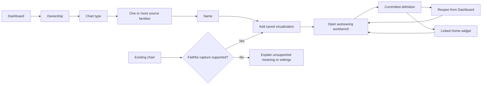
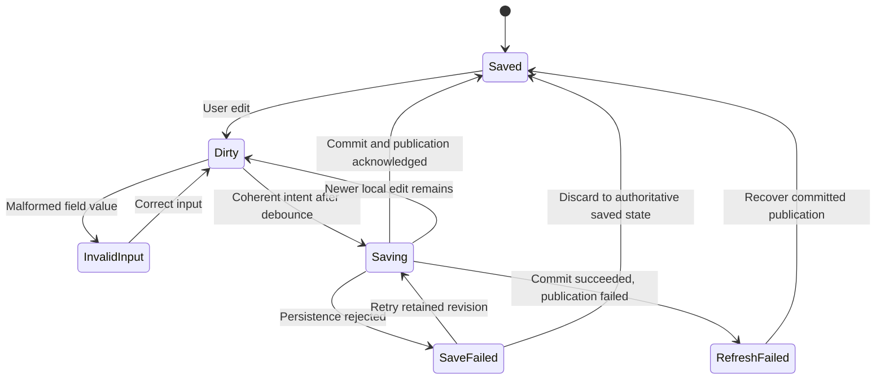

# V1 Visualization Foundation

This is the workflow and contract specification for [Vis1 / #2901](https://github.com/ORNL-AMO/VERIFI/issues/2901), within the [Visualizations and Home plan](v1-visualizations-and-home-plan.md). The decisions below were accepted on November 11, 2026. Vis1 introduces documentation and executable contract examples; it does not enable Visualizations, implement storage, or integrate production source providers or Home widgets.

## Ownership and saved intent

For the concrete utility implementation and definition-v2 display extension, see [Utility visualizations](v1-utility-visualizations.md). The identity, period, provenance and source-authority rules below remain its foundation.

A visualization belongs to one account and declares portfolio or single-facility scope. The account Dashboard lists all its visualizations; entering from a facility starts with that facility's filter. Explicitly browsing another scope does not change a definition. A single-facility account uses the same contracts, without requiring a hidden account-analysis record to become a separate user selection.

Scope and ownership are fixed for a saved identity. Ordinary Duplicate creates an independent identity with the same intent. Duplicate to another scope retains reusable presentation and period settings, but requires explicit review and replacement of incompatible resource references. Names are not source-mapping keys. Existing widgets continue referencing the original identity. Supported account/facility copy and backup GUID remapping belong to Vis2, not this editor operation.

Source selection is explicit:

- **Fixed:** identify exact resources by GUID. Rename changes labels, not identity. A missing selected resource blocks rendering and offers repair; it is never replaced or silently excluded from a total.
- **Rule-based:** save the scope and typed filter rule. New or removed matching members intentionally change the result. A missing rule anchor, such as a selected facility or group, is a broken reference rather than permission to broaden the rule.

Capture preserves the source chart's selection mode. Matching inventory results are distinct from checked rows and the current page. Overlapping meter/group membership must be deduplicated through authoritative source semantics before aggregation.

Persistent intent includes source identities and modes, measures, filters, aggregation, units, site/source treatment, selected series, period/comparison rules, appearance, and chart-specific settings. Each applicable unit or treatment setting declares **follow owner** or **pinned value**; capture retains the originating binding and interpretation. Runtime values, ECharts options, callbacks, route destinations, hover, zoom, and hierarchy drill position are excluded. A configured hierarchy is saved intent; the node temporarily inspected within it is session state.

## Create, capture, edit, and reopen

Add visualization is a stepped workflow: ownership, concrete chart type, one or more source families, then name. Preselected or single-facility ownership skips unavailable choices. Each selected family creates one setup source with independent local identity; the workbench later selects resources and repeated sources within a family. Creation saves coherent incomplete chart intent, without fabricated resources or series. The Dashboard and Home can therefore show setup-required items. Capture creates a saved item with a useful name immediately after faithful mapping succeeds; unsupported capture leaves the source chart unchanged. Failed creation retains the proposed definition for Retry and prevents repeated activation from creating duplicate records. A committed creation with failed publication must recover that identity rather than create it again.

The creation catalog offers chart setup intent before sources are configured; choosing a type or family does not establish rendering compatibility. Concrete source and chart adapters determine compatible combinations in Vis4–Vis8. Unavailable rendering explains the missing capability; users change sources or settings through the supported editors. Switching among compatible types retains shared settings and visibly initializes newly applicable controls. Supported mixed-source charts require declared alignment, compatible meaning, and appropriate axis settings. A renderer cannot make incompatible data compatible.

The workbench previews local coherent edits and autosaves them. Linked consumers use committed definitions, not the editor draft. Invalid field input stays local; a coherent definition may be saved even when setup is incomplete, sources are missing, or calculation is unavailable. This separates **definition validity**, **configuration completeness/compatibility**, and **runtime availability**.

Saves are serialized and tied to definition identity and edit revision. An acknowledgement updates the submitted baseline without overwriting newer input. Publication recovery does not replay a committed mutation. Before another queued mutation, the workspace command boundary recovers authoritative committed state. Failed edits retain recovery actions and navigation/unload protection. Conflicting external changes use the established saved-versus-local reconciliation pattern; silently overwriting either intent is not permitted.

Navigating away, switching scope/account, or deleting the edited item must resolve protected edits through existing guard and modal-portal patterns. Valid pending edits finish saving; invalid or failed input offers Stay/Retry where applicable or explicit Discard. Return navigation is allowlisted, session-owned context; it is not stored in the reusable definition. Reopen uses the saved source and date intent, never the ambient facility selection. Workbench layout, labels, keyboard controls, theme variants, underlying-value alternatives, and narrow-window behavior follow the existing v1 conventions in [AGENTS.md](../AGENTS.md).

## Periods, provenance, and unavailable states

New monthly utility charts use **all saved history**, which intentionally grows as saved history changes. Fixed ranges retain exact civil dates. Rolling ranges explicitly choose a calendar or latest-data anchor, with resolved dates visible. Latest-data anchors use the newest eligible observation among selected sources; lagging members retain gaps and partial-coverage notices. Calendar ranges do not imply that unsaved observations exist. Period-boundary, calendarization, fiscal-year, and unit interpretation remain owned by established VERIFI helpers and providers.

Energy Use-only setup defaults to an explicit **latest saved fiscal year** rule, with an option to pin a fiscal year. The resolved actual fiscal interval is visible. Portfolio annual values cannot be merged solely because their year labels match; incompatible fiscal intervals block the rollup. Mixed-family setup starts with all saved history, and adapters must explicitly review native period compatibility. Annual estimates are never resampled into invented monthly observations.

Comparisons support previous period, previous calendar/fiscal year, and explicit dates where provider capabilities permit them. Comparison alignment retains actual period meaning. Analysis baselines remain owned by the named analysis; visualization dates are display requests, not edits to baseline settings. Result charts follow the named analysis's current saved calculation. Model-inspection charts pin durable model identity; deleting it requires repair. An unsaved candidate is not a durable source.

| State | Required behavior |
| --- | --- |
| Loading or waiting for calculation | Show scoped progress; do not label old results current. Only active previews/embeddings request calculation. |
| Setup required | Preserve the saved item and identify missing configuration with Open setup. |
| Invalid input | Retain local input and explain correction; do not autosave malformed values. |
| Incompatible configuration | Preserve coherent intent, explain incompatibility, and block misleading rendering. |
| Empty data | Show the requested scope and resolved period with no-data guidance; do not replace missing observations with zero. |
| Missing source | Retain GUID references, block the chart, and offer explicit repair. Do not silently retarget. |
| Partial data | Render only when authoritative semantics allow it, with visible coverage and provenance. A partial observation is distinct from a missing required resource. |
| Invalid/stale analysis | Respect authoritative freshness and validation; show correction/recalculation actions instead of current-looking stale results. |
| Calculation failure | Show a scoped error and Retry; preserve the definition and cancel obsolete requests. |
| Save failure | Retain the draft and distinguish rejected persistence from committed-but-unpublished state. |
| Deleted visualization | A linked widget keeps its layout and offers Replace or Remove. |

Providers distinguish measured utility values, predictor observations, saved weather, estimates, carried-forward equipment values, modeled values, and savings. They preserve true zero, missing observations, alignment padding, exclusions, retirement, duplicates, and partial coverage as different meanings. Saved weather visualization does not fetch weather. Energy Use viewing does not create or rewrite annual history. Existing calculations and source records remain authoritative.

## Reuse on Home and later reports

A Home widget stores a saved visualization reference, not an independent copy. Editing the definition updates every appearance after commit. Duplicating a visualization is an explicit way to create independent intent. Duplicating a dashboard copies layout/settings while retaining its existing visualization links.

Any same-account visualization may be explicitly reused across portfolio/facility Home contexts. Its scope stays visible and unchanged. Cross-account references are invalid. Dashboard filters do not retarget sources or narrow portfolio membership. Date inheritance is opt-in and only available when the provider/chart capability permits it: an explicit widget date override wins over an opted-in dashboard date, which wins over the saved period; without opt-in the saved period wins. Unsupported overrides produce a clear unavailable state rather than being silently dropped. Appearance/layout overrides belong to the widget and never write back to the definition.

Deleting a referenced visualization reviews affected widgets before deletion. Home retains recoverable missing-definition placeholders in their layout. Removing a widget/dashboard never deletes its visualization. Home1–Home4 own implementation of these behaviors. Future custom reports can consume the same definition/provider/rendering boundaries; report authoring and existing report outputs are unchanged by Vis1.

## Focused chart and source dispositions

These are capture requirements and implementation handoffs, not claims that capture is available. Each feature owns its adapter: reusable chart components receive prepared data and cannot reconstruct authoritative source identity from ECharts options.

| Current v1 family and entrypoint | Source owner and meaning to preserve | Capture fidelity and compatible editing controls | Delivery |
| --- | --- | --- | --- |
| [Meter inventory charts](../src/app/v1/data/inventory/charts/inventory-chart.controller.ts) and [projections](../src/app/v1/data/meters/inventory/charts/meter-inventory-charts.ts) | Workspace calendarization and matching inventory GUIDs; energy, water, cost; owner units/treatment; facility/group/meter grouping | Preserve matching rule or fixed selection, grouping, selected metric/series, actual gaps, and style; reset zoom. Cost and consumption cannot be indiscriminately stacked. | Vis4, Vis6, Vis9 |
| [Predictor/weather inventory](../src/app/v1/data/predictors/inventory/charts/predictor-inventory-charts.ts) and [history views](../src/app/v1/data/predictors/predictor-chart.view.ts) | Saved predictor readings and weather definitions; month/occurrence alignment retains duplicates without sum/conversion | Individual histories retain units. Existing combined view explicitly says “Units ignored”; capture must preserve that raw comparison meaning or block until supported. No remote retrieval. | Vis5, Vis6, Vis9 |
| [Meter monthly charts](../src/app/v1/data/meters/meter-workbench/monthly-chart/meter-workbench-monthly-chart.component.ts) and [fiscal comparison](../src/app/v1/data/meters/meter-workbench/monthly-chart/fiscal-year-comparison-chart/meter-fiscal-year-comparison-chart.component.ts) | Named meter, authoritative monthly calendarization, meter-specific measures, facility fiscal start | Preserve meter GUID, measures, left/right axes, calendarization interpretation, selected years and fiscal alignment; no conversion between raw bills and monthly values without an explicit supported source setting. | Vis4, Vis6, Vis9 |
| [Bill charge overview](../src/app/v1/data/meters/meter-workbench/bill-inspection/overview-chart/bill-inspection-overview-chart.component.ts) and [charge correlation](../src/app/v1/data/meters/meter-workbench/bill-inspection/correlation-chart/bill-inspection-correlation-chart.component.ts) | Bill-inspection models own charge definitions, usage/demand interpretation, fitted results, and observation pairing | Retain meter and charge identity, X/Y measures, exclusions and charge semantics. Fit visibility never invents a different regression; unsupported charge identity/semantics block capture. | Vis4, Vis7, Vis9 |
| [Analysis group exploration](../src/app/v1/analysis/facility/workbench/group/visualization/group-visualization.facade.ts) | Analysis/group identity, calendarized group use, saved predictor observations, analysis baseline range, deterministic correlation summaries | Retain visible predictors and raw versus z-score mode; preserve pair exclusions/sample meaning and signed correlation versus R-squared. Zoom is temporary. | Vis5, Vis7, Vis9 |
| [Analysis result views](../src/app/v1/shared/analysis-results/chart/analysis-result-chart.view.ts) | Facility/group/account calculation services own current results, baseline, adjustments, savings, and banking distinctions | Persist named analysis/group and selected measures, monthly/annual intent, comparison-band meaning and banking gaps. Available chart types must preserve those semantics. | Vis5, Vis6, Vis9 |
| [Regression model comparison](../src/app/v1/shared/analysis-results/model-comparison-chart/analysis-model-comparison-chart.view.ts) | Regression workbench owns generated/user-defined model identity, fitting period, actual/modeled pairs, candidate versus selected model | Pin saved model identity and any saved comparison model. Unsaved candidates block capture; do not substitute the current selected model for a missing pinned one. | Vis5, Vis6, Vis9 |
| [Energy Use inventory treemap](../src/app/v1/data/energy-uses/inventory/charts/energy-use-charts.component.ts) and [denominators](../src/app/v1/data/energy-uses/inventory/charts/energy-use-treemap-results.models.ts) | Feature projections own latest saved year, actual facility fiscal intervals, equipment/group/source occurrences, saved-value provenance and full-scope denominators | Retain scope/filter intent, hierarchy, latest/pinned year, units and share denominator; reset drill position. Incompatible fiscal rollups remain unavailable. | Vis5, Vis8, Vis9 |
| [Energy Use results flows/comparisons](../src/app/v1/data/energy-uses/energy-use-workbench/results/energy-use-results-charts.ts) | Group/facility result and balance models own known contributions, metered consumption, unaccounted/overallocated values and partial coverage | Preserve source occurrence and denominator semantics. Never fabricate negative Sankey links; keep unsupported/negative contributions in accessible details. Treemap/donut/bar conversion requires compatible data shape. | Vis5, Vis8, Vis9 |
| [Analysis report result charts](../src/app/v1/reports/facility/analysis/result-charts/analysis-report-result-charts.component.ts) | Report presentation owns selected analysis and report-specific period/settings; shared result views only present prepared results | Capture from the feature adapter with durable report/analysis context and explicit period/measure settings. A prepared row array is insufficient provenance. Preserve report-only distinctions or block. | Vis5, Vis6, Vis9 |

Utility selection must additionally support emissions and supported other utility measures through Vis4's authoritative boundaries, even where the inventory UI currently offers only energy/water/cost. Chart breadth includes time series/comparisons (Vis6), scatter/correlation and heatmaps (Vis7), and composition/hierarchy/flows (Vis8). Existing chart availability is not evidence that every source/type combination is meaningful. Vis10 verifies the finished source/capture matrix; no exhaustive v0 inventory is required here.

## Contract and delivery handoff

Version-neutral contracts under [`domain/visualizations`](../src/app/domain/visualizations/) separate the saved JSON definition from runtime provider data and presentation. `VisualizationDefinition` retains intent; `VisualizationValidationResult` distinguishes malformed/unsupported, incomplete, and valid definitions; `VisualizationSourceProvider` describes and resolves source capabilities; `ChartCapability` explains compatible controls and combinations; `VisualizationCaptureResult` distinguishes faithful creation from unsupported capture; `VisualizationEmbeddingContext` keeps references and instance overrides separate. Concrete field definitions and exported functions live in source, not a competing schema in this document.

Providers return resolved periods, source identities, provenance, quality and unavailable reasons. Runtime identity includes account/workspace revision and request identity, with cancellation. Consumers must reject responses after a scope, account, definition or input revision changes. Typed source/chart variants do not admit arbitrary ECharts settings. Unknown versions/provider kinds return unsupported without destructive normalization; Vis2 owns preservation/migration of durable records. No browser, Angular, ECharts, database or Worker dependency belongs in the serializable domain definition.

Consumers establish one calendar date and latest-data anchor across the selected sources before resolution, then pass the requested chart projection and shared date context to each provider. Exact chart-setting approval belongs to the feature adapter; chart-kind registration alone is insufficient. Runtime evidence must match the requested source, series, settings, periods and comparison, as well as its identity. Opted-in widget dates that differ from existing evidence return a requires-resolution intent rather than relabeling old values. Additive totals require provider-declared, nonoverlapping contribution identities and compatible site/source treatment; comparison lines can retain separate interpretations without summing them.

Resolved periods must contain real, ordered civil dates and the requested primary/comparison roles. Fixed/custom requests accept native intervals that overlap their dates, including partial native months; providers keep original dates visible rather than relabeling a whole native observation as an exact partial period. Table rows must fit a declared interval of their role and overlap that role's requested dates. Selected table series have explicit observations or missing/excluded/padding values for every requested role; metadata alone cannot stand in for observations. Empty payloads use the empty state. Relative-period and fiscal-boundary calculations remain provider-owned.

| Local PR slice | Owned deliverable | Handoff and acceptance |
| --- | --- | --- |
| 1: `codex/vis1-workflow` | This workflow, focused dispositions, roadmap/context links | Workflow and chart-audit agents can investigate separately; one integrator owns the final document. Validate links and implementation facts. |
| 2: `codex/vis1-definition` | Serializable typed intent, decoder/validation and behavior tests | One owner controls exports; a test agent may add boundary cases after interfaces are pinned. Coherent incomplete definitions are saveable; malformed input is not. |
| 3: `codex/vis1-provider-contracts` | Provider/capability/capture/embedding contracts, pure decisions and fake-provider examples | Split files after interfaces stabilize; integrator reviews combined meaning. No real adapters, renderer or calculation coordinator. |

Stack the branches in that order, with the first PR targeting the `unified-ux` feature branch and each later PR targeting its predecessor. Vis2 implements persistence, GUID remapping, backup/copy and durable version upgrades. Vis3 implements Dashboard/workbench/autosave/navigation. Vis4–Vis8 implement concrete sources and compatible editing/rendering. Vis9 adds feature-owned capture actions. Home1–Home4 implement linked reuse; Vis10 completes integration acceptance. Each slice owns its focused tests. Existing v0 behavior, calculations, durable source records, supported formats, weather retrieval, Electron IPC and report outputs remain unchanged.

| Vis1 acceptance criterion | Evidence and downstream proof |
| --- | --- |
| Create/capture → save → reopen → Home, including failure states | Workflow/state diagrams and unavailable-state table above; Vis2/Vis3/Vis9/Home4 implement integration journeys. |
| Retain sources, filters, aggregation, units/treatment, series, dates and appearance | Serializable definition variants and representative round-trip tests in slices 2–3. |
| Linked Home semantics and independent Duplicate | Ownership/reuse rules and embedding contract validation; Home2–Home4 prove persistence and live linked updates. |
| Fixed/rule-based selection and persistent/session-state distinction | Ownership/capture rules and decoder/capture tests; Vis3/Vis9 prove routed behavior. |
| Focused current chart/source disposition and compatible controls | Matrix above and representative capability examples; Vis4–Vis9 supply adapters, Vis10 verifies final coverage. |

Review executable examples against a utility trend, analysis result, pinned model, Energy Use treemap/Sankey, portfolio and single-facility account. Protect round trips, unknown versions, incomplete intent, mixed-source and fiscal incompatibility, missing references, zero/gaps/partial data, analysis freshness, capture fidelity, date overrides, and stale request identity. Use fast tests for pure contracts; use the [validation planner](../.agents/skills/validate-web-and-electron/SKILL.md) to select final checks. Native persistence/Worker and visual interaction evidence belongs to the implementing downstream issue. Before publication, each PR follows the [two-stage review workflow](agents/pr-workflow.md), includes both review records, and uses non-closing `Connects #2901`; review does not authorize publication or merge.
